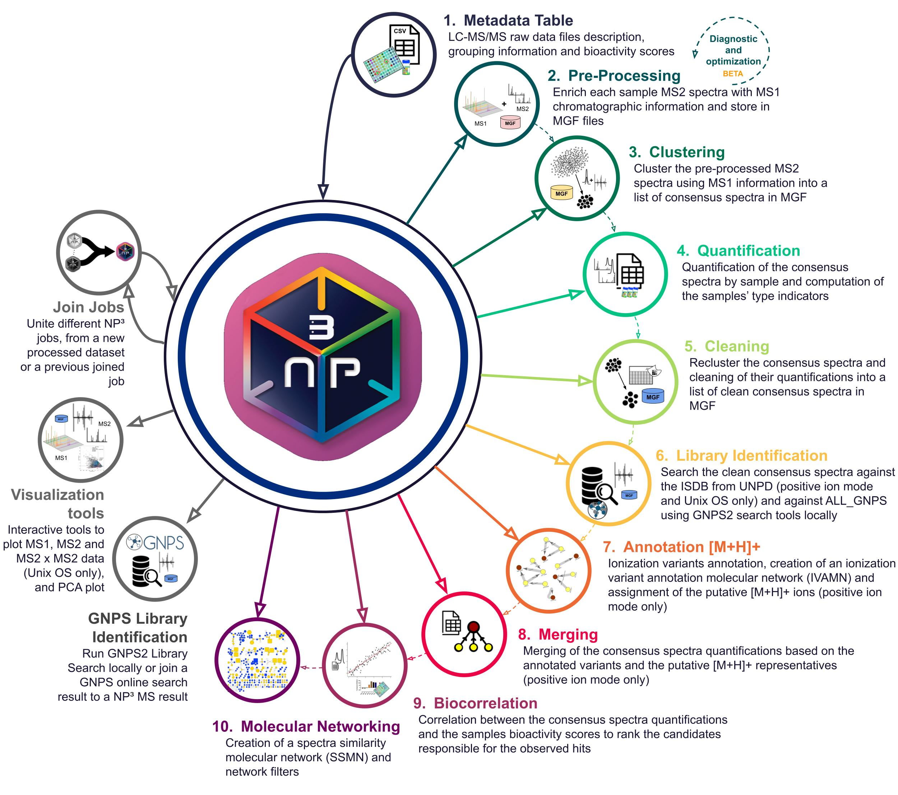

# NP³ MS Workflow 

## A Pipeline for LC-MS/MS Metabolomics Data Process and Analysis  

- - - - 

# Current Version 1.6.0

- NEW features:

  - (1.6.0) Standardized the final identification curation method and split the ALL_GNPS MGF library by ion mode (**setup** required). Updated some of the final reports chemical statistics.
      - Updated the names of the final curated library annotation columns using a prefix equals "curated_lib_annotation_*". More details in Manual Section 4.6.5.
      - Split the ALL_GNPS_NO_PROPOGATED.mgf in two MGF files, one with the positive ions and another with the negative ions. The library search procedure will choose the appropriated library depending on the ion_mode informed, positive or negative. The **setup** must be executed again for this modification to take effect.
        - Added ion_mode parameter in the **gnps_library_search** command. And retrieving the IonMode in the GNPS2 library annotations.
      - Updated some chemical statistics names according to the use of the final curated library annotation data. Counting the GNPS identifications using the gnps_SpectrumID instead of the SMILES, which may be empty.
      - Added a post process script to automatically build the SSMN in Cytoscape and create some reports by filtering the clean count table (code in src/post_process_analysis/ssmn_mount/).
  - (1.5.1) Bug fix in the join_jobs Step 7 when joining the IVAMNs. When the noise cutoff is applied the filtered IVAMN must reset its index to prevent matching errors in the next filters.
      - Bug fix in the superclass distribution plot, added missing class "Organohalogen_and_Organometallic".    
  - (1.5.0) A new command called **post_dd_analysis** was added to the NP³ MS Workflow! The *noise_cutoff* was changed to receive an absolute value.
      - The command post_dd_analysis is a post-process that creates some visualization analysis for drug discovery research.
      - Changed the superclass grouping plot from the final chemistry report to match the new plot being created in the post-processing drug discovery analysis; now this plotting correctly removes blanks and beds from the counts computation (it was not removing them as expected - bug); and uses the occurrence of the final library annotated m/z in each group instead of their peak area abundance by sample for the percentage distribution computation. 
      - The **noise_cutoff** is now the absolute value of the minimum base peak int (without normalization) that a MS2 must have to be kept after the clustering of Step 3, otherwise it is removed before the clean step 5.
      - The [M+H]+ networks are now created without culture media by default, the m/z that appears in bed samples are removed from the protonated networks.
      - Bug fix in the clean step 5 when the maximum number of clustering rounds is reached, there was a count table access after its removal. This removal is not performed if this is the last clustering round.
  - (1.4.2) Added extra test cases to compare the consistency of the NP³ results. Equality tests are performed at the end of each saved test case to guarantee reproducibility and correctness of the steps. The results of the NP³ test cases were stored in the fixed_results folder to serve this testing.
      - Added a summary of the test cases in the test command, counting the errors and storing their types to show at the end - improved debugging.
      - Changed the ordering of the components in the IVAMN output to make it reproducible, the components with the largest size are written first. And the edges are also sorted by the source node ID in numerical ordering.
      - Added a validation routine of the SMILES retrieved from GNPS2 Library Search in the enrichment process during the **setup** command. The **setup** must be executed again for this modification to take effect.
  - (1.4.1) Bug fix in the pre processing step, when reusing a previous pre processed result (partial pre processing). Now the MS1_no_MS2 table is correctly incremented and cleaned in further processing. The pre process statistics is also working now for a partial pre processing.
      - Added an error counting in the run and join_jobs commands, printing the detected errors by step at the end.
  - (1.4.0) Added experimental identification against GNPS2 libraries offline! The **setup** command must be executed again for changes to make effect and the conda environment was updated.
      - A new command was implemented, called **gnps_library_search**, which is capable of executing the GNPS2 Library Search workflow with some minor adaptations and full integration with the NP³ results and reports.
      - The ALL\_GNPS\_NO\_PROPOGATED library (all LC data present in GNPS2) is retrieved locally (**setup** command) and its annotations were previous enriched on April 2026 (no internet connection is needed).
      - This routine was also automated in the **run** command as step 6.1, which automatically identifies the result against GNPS2 experimental data.

- - - -

# NP³ Online in GNPS2 Workflows

The $NP^{3}$ MS workflow is included in the GNPS2 Workflows and may be executed online using their web interface. 
This interface includes the **pre_process**+**run** commands features (Steps 2 to 10) and 
the most important parameters. Using the desired parameters and one click, your job is submitted!

Search for "np3" in the GNPS2 workflows list: https://gnps2.org/workflows.

For a more personalized use, the full installation is required and the CLI must be used. 
Check the [NP³ MS Workflow documentation](https://crisfbazz.github.io/NP3_MS_Workflow_Nextflow/) for instructions.

- - - -

# Tutorial Videos

- [Tutorial 1](https://youtu.be/gtPhn5hPuuQ): Brief introduction, 'Getting Started' section and a [M+H]⁺ analysis (which is now automated in the current pipeline output since version 1.1.5)

- - - - 

# Overview 

The NP³ MS workflow1 is a tool to process and analyse LC-MS/MS data from targeted and untargeted metabolomics research 
with a single command!

The algorithms approach are focused on drug discovery (untargeted) with optimization towards natural products (NP). 
It ensures high sensitivity for minority compounds while distinguishing them from noise.

The NP³ MS workflow consists of ten major steps, where only the first requires user intervention, 
exemplified in the following image:

 

This workflow also contains some visualization commands and a command to join online GNPS library identifications.

The Steps 2 to 10 can be automatically executed with the NP³ MS Workflow command **run**. 
And different results from the NP³ MS Workflow may be united using the command **join_jobs**, which automatically 
executes Steps 3 to 10 with adaptations for joining previous results in an incremental clustering approach. 
At the end of the pipeline, final reports are created containing quantification, chemical and molecular networking 
statistics and plots. 

The chemical space of the identified result using PCA method is also created using a reference dataset for comparison 
and reproducibility. Check the 'Final Reports' section in the documentation for more details.

Check the 'Getting Started' section of the documentation for more details and an example of use!

# Documentation 

For the installations instructions, how to use and complete details of each step and command see the 
[NP³ MS Workflow documentation](https://crisfbazz.github.io/NP3_MS_Workflow_Nextflow/). 

- - - - 

### Cite

[NP3 MS Workflow](https://pubs.acs.org/doi/10.1021/acs.analchem.3c05829): An Open-Source Software System to Empower Natural Product-Based Drug Discovery Using Untargeted Metabolomics. Cristina F. Bazzano, Rafael de Felicio, Luiz Fernando Giolo Alves, Jonas Henrique Costa, Raquel Ortega, Bruna Domingues Vieira, Raquel Peres Morais-Urano, Luciana Costa Furtado, Everton L. F. Ferreira, Juliana R. Gubiani, Roberto G. S. Berlinck, Leticia V. Costa-Lotufo, Guilherme P. Telles, and Daniela B. B. Trivella.
Analytical Chemistry 2024 96 (19), 7460-7469
DOI: 10.1021/acs.analchem.3c05829
